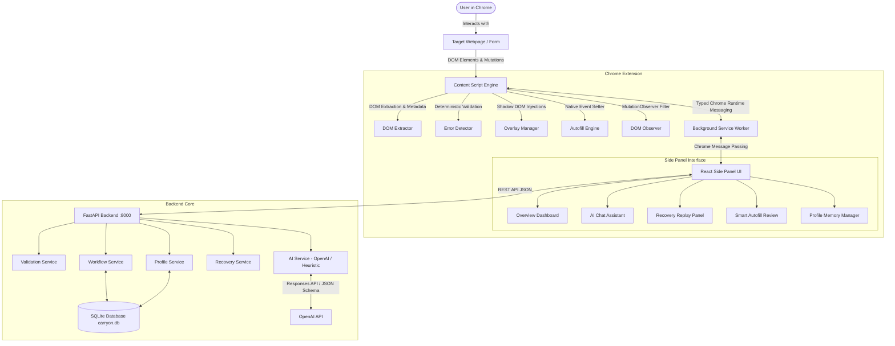

# CarryON AI — System Architecture Specification

## 1. Executive Summary

**CarryON AI** is an AI-powered browser workflow intelligence and recovery layer designed to prevent progress loss, resolve validation roadblocks, and automate context-aware workflows across complex web forms (such as job, internship, scholarship, and onboarding portals).

Conventional assistants simply answer user questions in an isolated chat window. CarryON takes a fundamentally different approach:
- Directly observes and interacts with webpage DOM elements.
- Identifies form field semantic intent and constraints.
- Injects non-intrusive, isolated inline visual highlights and diagnostic tooltips.
- Provides user-approved autofill using locally saved, structured profile memory.
- Maintains a persistent state machine of workflow progress and checkpoints.
- Performs **Recovery Replay** to restore interrupted sessions after crashes, reloads, or session timeouts.

---

## 2. High-Level System Architecture

---

## 3. Core Architectural Principles & Invariants

1. **Safety First — Predefined & Validated Execution Layer**:
   The AI or backend **never** sends raw arbitrary JavaScript strings to be evaluated on the webpage (`eval()` or `new Function()` are strictly prohibited). Every action requested by the AI or user must map to a predefined, typed action (`highlight_field`, `scroll_to_field`, `fill_field`, `clear_highlight`, `suggest_correction`, `clean_overlays`).
   
2. **Explicit User Approval for Actions**:
   Autofill and field value mutations require explicit user review and confirmation. Users can approve all matched fields or toggle individual fields.

3. **Privacy by Design**:
   - Passwords, OTPs, PINs, CVVs, and payment credentials are **never extracted, never saved in checkpoints, and never transmitted to the OpenAI API**.
   - Profile information and workflows are saved in a local SQLite database (`carryon.db`) in a single-user environment.
   - Webpage content is treated as untrusted data.

4. **Resilient Offline / Deterministic Fallbacks**:
   The application operates cleanly and reliably even when an OpenAI API key is not configured or when network connectivity is lost. The deterministic validation engine handles phone formats, email regex, negative experience numbers, missing fields, and heuristic profile matching.

5. **Infinite Observation Loop Prevention**:
   The `DOMObserver` MutationObserver attaches to `document.body` but specifically filters out mutations occurring inside CarryON's own injected elements (`[data-carryon-overlay]`). This ensures CarryON never triggers recursive self-mutating observation cascades.

---

## 4. Subsystem Breakdown

### 4.1 Content Script Interaction Engine
- **`dom-extractor.ts`**:
  - Traverses the DOM for editable form elements (`input`, `select`, `textarea`).
  - Assigns a stable identifier `data-carryon-id` to each element so lookups execute in $O(1)$ time without brittle CSS selectors.
  - Resolves field labels using `<label for="...">`, enclosing `<label>`, `aria-label`, `aria-labelledby`, preceding sibling headings, and placeholders.
  - Associates fields with parent steps/sections using `section[data-section-name]` or heading hierarchy.
- **`error-detector.ts`**:
  - Inspects field values deterministically for common blockers:
    - Alphabetic characters in phone fields.
    - Invalid email patterns.
    - Negative numeric constraints on years of experience.
    - Missing required fields.
    - Browser native validation states (`validity.valid === false`).
    - Error message tags adjacent to the field.
- **`overlay-manager.ts`**:
  - Manages visual interventions on the webpage.
  - Adds red outline/box-shadow to invalid elements while caching original styling.
  - Attaches an isolated Shadow DOM container containing a diagnostic card and a quick "Dismiss" button.
  - Reverts styles and cleanly removes injected nodes upon field correction.
- **`autofill-engine.ts`**:
  - Sets field values using the native prototype descriptor (`prototypeValueSetter.call(el, value)`) so modern UI frameworks (React, Vue, Angular) properly update their internal state.
  - Dispatches `input`, `change`, and `blur` events with `{ bubbles: true }`.
  - Re-evaluates field validity and automatically clears error highlights once the field is valid.

### 4.2 React Side Panel UI
- Built with React 18, TypeScript, Tailwind CSS, and Lucide icons.
- Designed with a dark-first aesthetic (`#0B0D12` background, `#121620` surfaces, `#8B7CFF` accent, `#36CFC9` secondary accent).
- Operates inside the Chrome Side Panel API (`chrome.sidePanel`) to live alongside the user's browsing experience without blocking page content.
- Modular component layout:
  - `Header`: Connection status, AI status indicator, page rescan button, settings.
  - `Sidebar` (NavTabs): Tab switcher for Overview, Assistant, Recovery, Autofill, and Profile.
  - `Dashboard`: Active workflow status, progress bar, application roadmap steps.
  - `AssistantChat`: Contextual question answering, starter prompts, field explanation cards with one-click "Locate in page".
  - `RecoveryPanel`: Active blockers list, checkpoint history, and one-click "Restore Progress" with confirmation.
  - `AutofillPanel`: Smart field matching table with individual checkboxes, match percentage badges, and "Approve & Autofill".
  - `ProfileManager`: Local single-user profile manager with an interactive skill tags editor.

### 4.3 FastAPI Backend & SQLite Database
- Modular monolith structured into routers, schemas, services, and models.
- **Database (`database.py`)**:
  - SQLite with foreign keys enforced via PRAGMA `foreign_keys=ON`.
  - Tables: `UserProfile`, `Workflow`, `WorkflowStep`, `Checkpoint`.
  - Auto-initializes on startup.
- **Services**:
  - `ai_service.py`: Integrates with OpenAI API using structured schemas. Falls back to deterministic heuristics when API key is missing.
  - `validation_service.py`: Performs server-side validation checks.
  - `profile_service.py`: Manages profile CRUD.
  - `workflow_service.py`: Manages workflow lifecycle and checkpoint snapshots.
  - `recovery_service.py`: Prepares recovery diffs and verifies restored values.

---

## 5. Security & Privacy Framework

| Threat Vector | Mitigation Strategy |
| :--- | :--- |
| **Prompt Injection from Untrusted Web Content** | Webpage text is treated strictly as untrusted data. Prompts clearly isolate webpage content from system instructions. |
| **Arbitrary Code Execution** | No evaluation of raw JavaScript strings returned by LLMs. Actions map to a fixed enum of client-side functions. |
| **Credential & Sensitive Data Leakage** | Passwords, OTPs, CVVs, and credit cards are filtered out during extraction, excluded from snapshots, and prevented from being autofilled. |
| **API Key Exposure** | The `OPENAI_API_KEY` is maintained strictly within the backend `.env`. It is never bundled into or accessible by the Chrome extension. |
| **Unintended Submissions** | CarryON **never** automatically clicks form submit buttons. Final submission requires direct user confirmation. |
